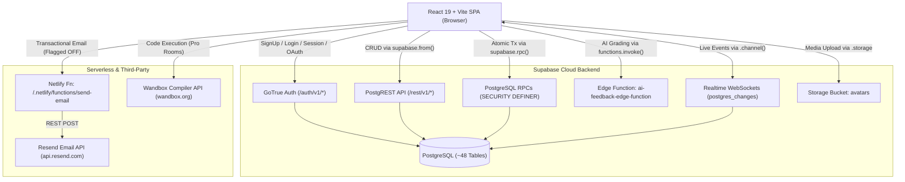
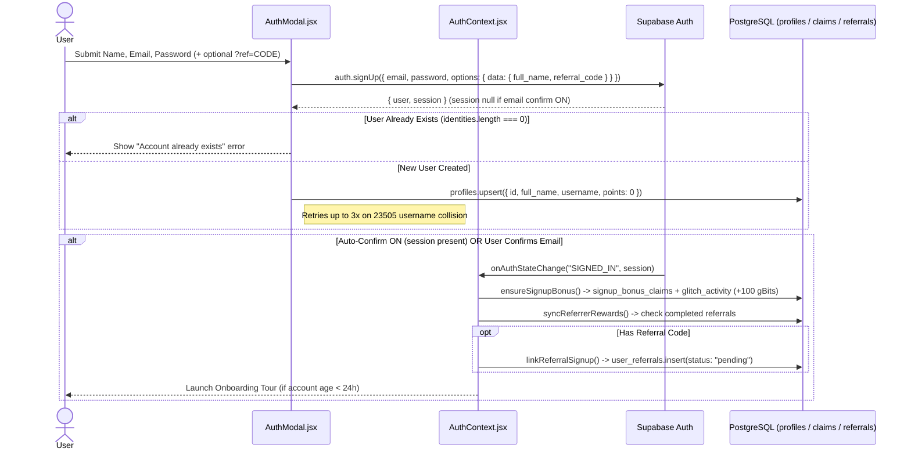
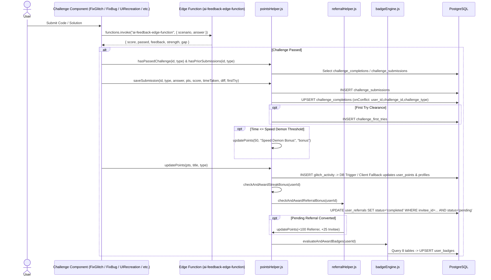
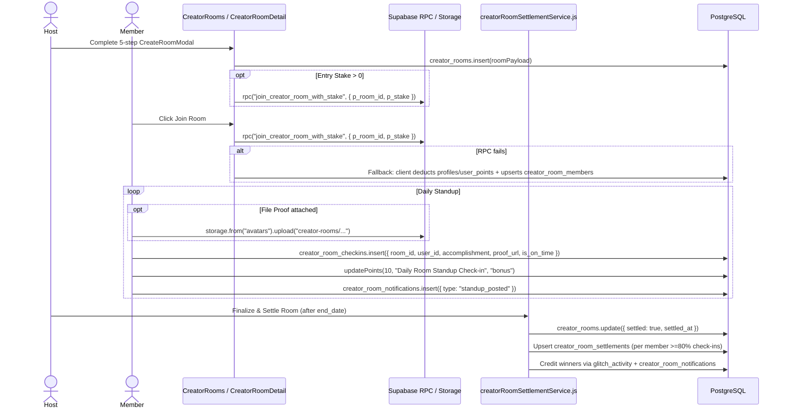
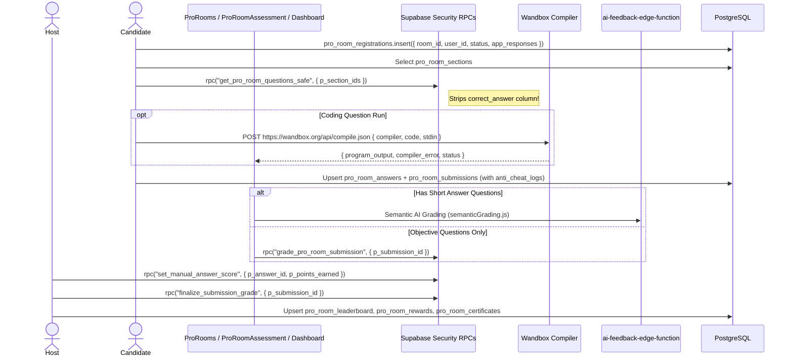

# Glitch Room — Flow-Wise API & Backend Architecture Blueprint (CTO Edition)

> **Perspective:** Architectural & Security Review (`rules.md`: Think as a CTO)  
> **Stack:** React 19 + Vite SPA ➔ Supabase (GoTrue Auth, PostgREST, PostgreSQL RPCs, Edge Functions, Realtime, Storage) + Netlify Functions + External Execution APIs  
> **Scope:** Exhaustive flow-wise inventory of all client-to-backend APIs, RPCs, Edge Functions, Realtime subscriptions, Storage operations, tables touched, payloads, responses, and production risk assessments.

---

## 1. High-Level System Architecture



---

## 2. Complete Backend Interface Inventory

| Layer | Identifier | Purpose | Source Location |
| :--- | :--- | :--- | :--- |
| **Edge Function** | `ai-feedback-edge-function` | LLM evaluation for challenges & short-answer semantic grading | `semanticGrading.js`, `FixGlitch.jsx`, `FixBug.jsx`, `FixAIChallenge.jsx`, `FixCreativeSpark.jsx`, `Explore.jsx`, `AIvsHuman.jsx`, `UIRecreation.jsx`, `ArenaChallenge.jsx` |
| **Netlify Function** | `/.netlify/functions/send-email` | Dispatches emails via Resend API *(Currently feature-flagged OFF)* | `netlify/functions/send-email.js`, `src/services/emailService.js` |
| **External API** | `https://wandbox.org/api/compile.json` | Compiles & executes candidate code against test cases | `ProRoomAssessment.jsx` |
| **External API** | `https://api.resend.com/emails` | Client-side fallback email dispatch *(Flagged OFF)* | `src/services/emailService.js` |
| **Storage Bucket** | `avatars` | Stores user avatars, profile banners, room standup proofs, and pro room resources | `YourProfile.jsx`, `CreatorRoomDetail.jsx`, `CreateProRoomPage.jsx` |
| **RPC (Auth)** | `delete_user_account()` | Self-deletion of authenticated user and dependent data | `Settings.jsx` |
| **RPC (Stats)** | `get_total_profiles_count()` | Returns aggregate user count bypassing row read limits | `Hero.jsx` |
| **RPC (Creator Rooms)** | `join_creator_room_with_stake(p_room_id, p_stake)` | Atomically deducts gBits stake & inserts `creator_room_members` | `CreatorRooms.jsx`, `CreatorRoomDetail.jsx` |
| **RPC (Creator Rooms)** | `refund_and_delete_creator_room(p_room_id)` | Refunds active member stakes & deletes room | `CreatorRoomDetail.jsx`, `DeleteRoomModal.jsx` |
| **RPC (Pro Rooms)** | `get_pro_room_questions_safe(p_section_ids)` | Returns questions while stripping `correct_answer` from client exposure | `ProRoomAssessment.jsx`, `ProRoomDashboard.jsx`, `CreateProRoomPage.jsx` |
| **RPC (Pro Rooms)** | `grade_pro_room_submission(p_submission_id)` | Server-side auto-grading trigger for objective answers | `ProRoomAssessment.jsx` |
| **RPC (Pro Rooms)** | `set_manual_answer_score(p_answer_id, p_points_earned)` | Host/AI manual score assignment per answer | `ProRoomDashboard.jsx` |
| **RPC (Pro Rooms)** | `finalize_submission_grade(p_submission_id)` | Finalizes candidate total score, percentage & leaderboard state | `ProRoomDashboard.jsx` |
| **RPC (Pro Rooms)** | `regrade_submissions_for_question(p_question_id)` | Re-evaluates all candidate submissions when a question is edited | `CreateProRoomPage.jsx` |
| **RPC (Pro Rooms)** | `reply_pro_room_help_ticket(p_ticket_id, p_reply)` | Host reply persistence for live assessment help tickets | `ProRoomHelpModal.jsx`, `ProfessionalRoomDetail.jsx` |

---

## 3. Flow-Wise Detailed API Breakdown

---

### Flow 1: User Authentication, Registration, Onboarding & Account Deletion

#### Sequence Diagram


#### API Endpoints & Payloads

1. **Sign Up** (`AuthModal.jsx`)
   - **Call:** `supabase.auth.signUp({ email, password, options })`
   - **Endpoint:** `POST /auth/v1/signup`
   - **Payload:**
     ```json
     {
       "email": "dev@example.com",
       "password": "********",
       "options": {
         "data": { "full_name": "Sameer", "referral_code": "GLITCH-12AB34CD" },
         "emailRedirectTo": "https://joinglitchroom.com"
       }
     }
     ```
   - **Follow-up DB Write:** `supabase.from("profiles").upsert({ id, full_name, username, points: 0 }, { onConflict: "id" })`
   - **Tables Touched:** `auth.users`, `profiles`

2. **Resend Verification Email** (`AuthModal.jsx`)
   - **Call:** `supabase.auth.resend({ type: "signup", email, options: { emailRedirectTo } })`
   - **Endpoint:** `POST /auth/v1/resend`

3. **Login** (`AuthModal.jsx`)
   - **Call:** `supabase.auth.signInWithPassword({ email, password })`
   - **Endpoint:** `POST /auth/v1/token?grant_type=password`

4. **Forgot / Reset Password** (`AuthModal.jsx` & `ResetPassword.jsx`)
   - **Trigger Reset:** `supabase.auth.resetPasswordForEmail(email, { redirectTo: ".../reset-password" })` (`POST /auth/v1/recover`)
   - **Update Password:** `supabase.auth.updateUser({ password })` (`PUT /auth/v1/user`)

5. **Post-Login Welcome Bonus** (`pointsHelper.js -> ensureSignupBonus`)
   - **Reads:** `signup_bonus_claims`, `glitch_activity`, `profiles.points`, `auth.getUser()`
   - **Atomic Lock Write:** `supabase.from("signup_bonus_claims").insert({ user_id })` (Unique constraint guards concurrency)
   - **Award:** `updatePoints(100, "🎉 Welcome Bonus", "signup")`

6. **Link Referral on Signup** (`referralHelper.js -> linkReferralSignup`)
   - **Reads:** `user_referrals` (dedupe check), `profiles` (resolve referrer by `referral_code`)
   - **Write:** `supabase.from("user_referrals").insert({ referrer_id, invitee_id, referral_code, status: "pending" })`

7. **Delete Account** (`Settings.jsx`)
   - **Call:** `supabase.rpc("delete_user_account")` ➔ `supabase.auth.signOut()`
   - **Tables Touched:** Child tables + `profiles` + `auth.users`

> **CTO Risk Assessment (Flow 1):**
> 1. **Email Confirm vs RLS Deadlock:** When `mailer_autoconfirm` is `false`, `signUp()` returns `session: null`. Immediately afterward, `AuthModal.jsx` tries `profiles.upsert()` as an unauthenticated client (`auth.uid() = NULL`). If RLS requires `auth.uid() = id`, profile creation fails silently on signup and is not re-attempted inside `AuthContext.jsx` on `SIGNED_IN`.
> 2. **SMTP Fragility:** Supabase's default built-in SMTP returns `500 Error sending confirmation email` once the 3-4 emails/hour limit hits. Production requires either Custom SMTP (Resend) or disabled confirmation.
> 3. **RPC Dependency:** `delete_user_account` is invoked via RPC; if not deployed in Postgres SQL Editor, account deletion fails.

---

### Flow 2: Challenge Solving, AI Grading, Points Ledger, Streaks & Badges

#### Sequence Diagram


#### APIs & Tables
1. **Fetch Challenges:** `supabase.from("challenges").select("*")` & `supabase.from("arena_events").select("*")`
2. **AI Evaluation Edge Function:**
   - **Call:** `supabase.functions.invoke("ai-feedback-edge-function", { body: { scenario, answer } })`
   - **Endpoint:** `POST /functions/v1/ai-feedback-edge-function`
   - **Response:** `{ score: number, feedback?: string, strength?: string, gap?: string, passed?: boolean }`
3. **Submission & Completion Ledger:**
   - `challenge_submissions.insert({ user_id, challenge_id, challenge_type, answer, points_earned, score, time_taken_seconds })`
   - `challenge_completions.upsert({ user_id, challenge_id, challenge_type, score, points_earned, completed_at })`
   - `challenge_first_tries.insert({ user_id, challenge_id, challenge_type })`
4. **Points Single Read / Write Path** (`pointsHelper.js`):
   - **Read (`fetchPoints`):** Reads BOTH `user_points.points` and `profiles.points` in parallel and takes `Math.max(userPts, profPts)`.
   - **Write (`updatePoints`):** Inserts row into `glitch_activity` (`user_id, title, points, type`), waits for DB trigger to sync, then executes a client-side fallback upsert on `user_points` and `profiles` if balance didn't move.
   - **Streak Bonus (`checkAndAwardStreakBonus`):** Reads `glitch_activity` + `user_points.last_streak_bonus_at` (epoch int) and awards milestone bonuses.
5. **Referral Settlement** (`checkAndAwardReferralBonus`):
   - Atomic `UPDATE user_referrals SET status = 'completed', completed_at = NOW() WHERE invitee_id = $1 AND status = 'pending'`.
   - Awards **+100 gBits** to referrer (synced when referrer logs in via `syncReferrerRewards`) and **+25 gBits** to invitee.
6. **Badge Engine** (`evaluateAndAwardBadges`):
   - Parallel queries to: `glitch_activity`, `challenge_submissions`, `challenge_completions`, `profiles`, `user_points`, `user_referrals`, `rooms`, `arena_completions`, `user_badges`.
   - Upserts newly unlocked badges into `user_badges` (`onConflict: "user_id,badge_id"`).

> **CTO Risk Assessment (Flow 2):**
> 1. **Dual-Balance Drift & Client-Side Fallback Risk:** Maintaining points in 3 places (`glitch_activity` ledger, `user_points`, `profiles`) and using `Math.max()` with client-side fallback updates means a compromised client with browser DevTools could potentially write directly to `profiles.points` or `glitch_activity` unless RLS strictly restricts direct client inserts/updates and moves points computation 100% into PostgreSQL triggers/RPCs.
> 2. **Cross-User Referral Credit:** `checkAndAwardReferralBonus` tries to call `updatePoints(..., referral.referrer_id)` from the invitee's browser session. Under strict RLS (`auth.uid() = user_id`), this fails silently for the referrer—which is why `syncReferrerRewards` was added as a self-healing loop when the referrer logs in.

---

### Flow 3: Creator Accountability Rooms, Daily Standups & Stake Settlements

#### Sequence Diagram


#### APIs & Tables
1. **Room Discovery & Realtime:**
   - Queries `creator_rooms` (with fallback to legacy `rooms` table in `roomCountHelper.js` / `badgeEngine.js`).
   - Realtime subscriptions: `hero-rooms`, `join-rooms-sub`, `room-detail-${id}`.
2. **Atomic Staked Join & Host Creation:**
   - `supabase.rpc("join_creator_room_with_stake", { p_room_id, p_stake })`
   - **Tables:** `profiles`, `user_points`, `creator_room_members`, `glitch_activity`
3. **Daily Standups, Proof Storage & Social Interactions:**
   - Storage Upload: `supabase.storage.from("avatars").upload("creator-rooms/{roomId}/{userId}/{file}")`
   - Check-in Write: `creator_room_checkins.insert(...)`
   - Likes: `creator_room_checkin_likes`
   - Buddies: `creator_room_buddies`
   - Events/Logs: `creator_room_events`
   - Notifications & Read Receipts: `creator_room_notifications`, `creator_room_notification_reads`
4. **Settlement & Payout Engine** (`creatorRoomSettlementService.js`):
   - Verifies host authorization (`room.created_by === callerUserId`) & idempotency (`!room.settled`).
   - Locks room via `creator_rooms.update({ settled: true, settled_at })`.
   - Computes ≥80% consistency winners, distributes completion rewards + forfeited stake pool.
   - Persists records in `creator_room_settlements` and credits active user via `glitch_activity`.
5. **Room Deletion & Stake Refund:**
   - `supabase.rpc("refund_and_delete_creator_room", { p_room_id })`

> **CTO Risk Assessment (Flow 3):**
> 1. **Client-Side Stake Deduction Fallback:** In `CreatorRooms.jsx`, if `join_creator_room_with_stake` RPC fails for any non-business reason, it falls back to reading `fetchPoints()` on the client, updating `profiles.points`, and then inserting into `creator_room_members`. Without an atomic DB transaction, a network drop between points update and member insert loses user funds, and client-writable `profiles.points` weakens financial integrity.
> 2. **Base64 Proof Bloat:** If Supabase Storage upload fails, `CreatorRoomDetail.jsx` converts the uploaded image/file to a Base64 Data URL and stores it directly inside `creator_room_checkins.proof_url`. This can severely bloat PostgreSQL row sizes and degrade feed query latency.
> 3. **Legacy Table Fragmentation:** Code still contains references to both `rooms`/`room_members`/`room_checkins` and `creator_rooms`/`creator_room_members`/`creator_room_checkins`. Should be consolidated and legacy tables dropped.

---

### Flow 4: Professional Rooms (Pro Rooms), Timed Assessments, Compilation & Grading

#### Sequence Diagram


#### APIs & Tables
1. **Room Creation & Question Authoring** (`CreateProRoomPage.jsx`):
   - Tables: `pro_rooms`, `pro_room_sections`, `pro_room_questions`, `pro_room_resources` (plus `storage.from("avatars")` for files).
   - Question Edit Regrading: `supabase.rpc("regrade_submissions_for_question", { p_question_id })`.
2. **Candidate Registration** (`ProRoomRegistrationModal.jsx`):
   - `supabase.from("pro_room_registrations").insert({ room_id, user_id, status: "pending" | "approved", app_responses })`
3. **Assessment Execution** (`ProRoomAssessment.jsx`):
   - **Secure Question Fetch:** `supabase.rpc("get_pro_room_questions_safe", { p_section_ids })` (Mitigates answer key inspection in Network tab).
   - **Live Code Compiler:** `POST https://wandbox.org/api/compile.json`
     - Payload: `{ compiler, code, stdin }`
     - Response: `{ status, program_output, compiler_error, program_error, signal }`
   - **Answer & Submission Persistence:**
     - `pro_room_answers` (per question answer + execution test results)
     - `pro_room_submissions` (`onConflict: "room_id,user_id"`, includes `anti_cheat_logs: blurEvents`)
   - **Grading:**
     - Objective: `supabase.rpc("grade_pro_room_submission", { p_submission_id })`
     - Subjective/Short Answer: `semanticGrading.js` calls `ai-feedback-edge-function` (falls back to local keyword matching if Edge function times out).
4. **Host Dashboard, Rewards & Certificates** (`ProRoomDashboard.jsx`):
   - Manual score override: `supabase.rpc("set_manual_answer_score", { p_answer_id, p_points_earned })`
   - Finalize submission: `supabase.rpc("finalize_submission_grade", { p_submission_id })`
   - Results & Recognition: `pro_room_leaderboard`, `pro_room_rewards`, `pro_room_certificates`, `pro_room_announcements`, `pro_room_notifications`, `user_badges`.
5. **Discussions & Live Help Desk** (`ProfessionalRoomDetail.jsx`, `ProRoomHelpModal.jsx`):
   - Discussions: `pro_room_discussions`, `pro_room_discussion_replies`
   - Live Tickets: `pro_room_help_tickets` + Realtime channels (`pro-room-tickets-live-${id}`, `modal-tickets-live-${id}`)
   - Host Reply: `supabase.rpc("reply_pro_room_help_ticket", { p_ticket_id, p_reply })`

> **CTO Risk Assessment (Flow 4):**
> 1. **External Compiler SPOF:** Assessment code execution directly calls `wandbox.org` from the browser. If 100+ candidates submit coding tests concurrently during a university hiring event, Wandbox rate-limits (HTTP 429/503) or CORS/network instability will block assessments. **Action:** Proxy code execution through a dedicated, rate-controlled Judge0 / isolated runner microservice.
> 2. **Excellent Security Pattern:** `get_pro_room_questions_safe` properly prevents candidates from reading `correct_answer` via browser Network DevTools. This pattern should be standardized across all challenge types.

---

### Flow 5: Terminal Wall (Global Leaderboards), Developer Console & Profiles

#### APIs & Tables
1. **Hero Live Stats** (`Hero.jsx`):
   - `supabase.rpc("get_total_profiles_count")`
   - Queries `creator_rooms`, `pro_rooms`.
   - Realtime subscriptions: `hero-rooms`, `hero-pro-rooms`, `hero-profiles`.
2. **Global Leaderboard** (`TerminalWall.jsx`):
   - Fetches from `profiles`, `glitch_activity`, `challenge_submissions`, `arena_completions` and aggregates scores by time window (`Today`, `This Week`, `All-Time`).
3. **Developer Console** (`Console.jsx`):
   - Reads `profiles`, `glitch_activity`, `user_badges`, `pro_room_certificates`.
   - Realtime channel: `console-points` listening to `glitch_activity` / `user_points`.
4. **User Profile & Media Management** (`YourProfile.jsx`):
   - Reads `profiles`, `community_posts`, `community_comments`, `challenge_submissions`, `glitch_activity`, `pro_room_certificates`.
   - Avatar & Banner Upload:
     - `supabase.storage.from("avatars").upload("{userId}/avatar_{ts}.jpg", blob, { upsert: true })`
     - `supabase.storage.from("avatars").getPublicUrl(...)`
     - `profiles.update({ avatar_url })` + `auth.updateUser({ data: { avatar_url } })`

> **CTO Risk Assessment (Flow 5):**
> 1. **O(N) Full-Table Client Aggregation:** `TerminalWall.jsx` pulls raw rows from `profiles`, `glitch_activity`, `challenge_submissions`, and `arena_completions` to aggregate rankings in the browser. At >5,000–10,000 users, this will exceed PostgREST row limits (default 1,000 rows) and crash client memory. **Action:** Replace with parameterized PostgreSQL Views or paginated RPCs (`get_leaderboard(p_timeframe, p_limit, p_offset)`).
> 2. **Storage Bucket Overloading:** The `avatars` bucket stores profile avatars, banners, Creator Room proof files, and Pro Room resources. **Action:** Split into separate buckets (`avatars`, `room-proofs`, `pro-room-assets`) with distinct file-size limits, MIME restrictions, and retention policies.

---

### Flow 6: Community Forum, Arena Events, Daily Fact & Transactional Email

#### APIs & Tables
1. **Community Discussions** (`Community.jsx`, `CommunityPost.jsx`):
   - `community_posts` (CRUD posts, upvotes)
   - `community_comments` (Insert/read threaded comments)
   - Joins author metadata from `profiles`.
2. **Arena Events & Voting Feed** (`ArenaEvents.jsx`, `ArenaChallenge.jsx`, `ArenaVotingFeed.jsx`, `About.jsx`):
   - `arena_events`, `arena_completions`, `arena_submissions`, `arena_pitch_reactions`
   - AI judging via `ai-feedback-edge-function`
   - Realtime channel: `about-arena-events`
3. **Daily Fact Bubble** (`DailyFactBubble.jsx` + `pointsHelper.js`):
   - Reads `daily_facts`, `daily_fact_reactions` (Realtime channel: `daily_fact_reactions:${fact.id}`)
   - Claim Bonus: `daily_fact_claims.insert({ user_id, claim_date })` (unique per user per day) ➔ awards **+10 gBits**.
4. **Newsletter** (`Newsletter.jsx`):
   - `supabase.from("newsletter_subscribers").insert({ email })` (Handles duplicate `23505`).
5. **Email Service** (`src/services/emailService.js` + `netlify/functions/send-email.js`):
   - `POST /.netlify/functions/send-email` ➔ `POST https://api.resend.com/emails`
   - **Status:** Currently hard-disabled via `EMAIL_NOTIFICATIONS_ENABLED = false` and an early `200 OK` return in the Netlify handler.

---

### Flow 7: Admin Operations & Data Migration

#### APIs & Tables (`AdminDashboard.jsx`)
1. **Admin Gate** (`App.jsx`):
   - `supabase.from("profiles").select("is_admin").eq("id", user.id).single()`
2. **Challenges Manager:**
   - Full CRUD on `challenges` (`select`, `insert`, `update`, `delete`).
3. **Arena Events Manager:**
   - Full CRUD on `arena_events` (`select`, `insert`, `update`, `delete`).
4. **1-Click Migration Tool:**
   - Reads local JSON files (`glitches.json`, `debug_mode_challenges.json`, `ai_challenges.json`, `creative_sparks_challenges.json`, `exploreChallengesData.js`, `arenaEventsData.js`) and bulk inserts/normalizes into `challenges` and `arena_events`.

> **CTO Risk Assessment (Flow 7):**
> - Ensure RLS policies on `challenges` and `arena_events` strictly verify `EXISTS (SELECT 1 FROM profiles WHERE id = auth.uid() AND is_admin = true)` for `INSERT`/`UPDATE`/`DELETE`. Client-side route guarding in `App.jsx` alone is insufficient against direct PostgREST API calls.

---

## 4. CTO Strategic Action Plan (Prioritized Remediation)

| Priority | Finding | Impact | Recommended Fix |
| :--- | :--- | :--- | :--- |
| **P0 (Critical)** | **Client-Side Points & Stake Fallbacks** | Users could tamper with `profiles.points` or lose stake on partial failures if RPCs fail | Remove all client-side mutations to `profiles.points` and `user_points`. Lock columns via RLS and perform all point/stake/referral transactions exclusively inside `SECURITY DEFINER` RPCs or DB triggers. |
| **P0 (Critical)** | **Schema Drift / Missing Tables in Target DB** | Live probe on `tuuzybflsbtgdxuqhxvy` returned `PGRST205` (missing `profiles` / `challenges`) and `500` on signup email | Version-control all SQL DDL, RLS policies, and RPCs inside `supabase/migrations/` and verify via CI/CD before deployment. |
| **P1 (High)** | **Third-Party Exam Code Runner (`wandbox.org`)** | External free compiler will rate-limit/fail during concurrent Pro Room hiring drives | Deploy a self-hosted Judge0 instance or dedicated sandboxed execution worker behind an Edge Function/API proxy. |
| **P1 (High)** | **Client-Side Leaderboard Aggregation** | `TerminalWall.jsx` aggregates raw tables in-browser; breaks past 1,000 PostgREST rows | Move aggregation into indexed PostgreSQL views or a paginated `get_leaderboard` RPC. |
| **P2 (Medium)** | **Base64 File Fallback in Postgres** | `CreatorRoomDetail.jsx` writes raw Base64 file payloads into text columns if storage fails | Enforce Storage upload limits and reject Base64 DB persistence; fix Storage bucket RLS instead. |
| **P2 (Medium)** | **Dual/Legacy Table Duplication** | Co-existence of `rooms` & `creator_rooms`, plus single `avatars` bucket for all assets | Deprecate and drop legacy `rooms`/`room_*` tables; partition Storage into dedicated buckets. |
